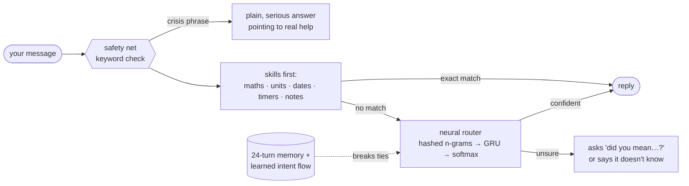

<div align="center">

# TinyBot

**A 251k-parameter neural chatbot, written from scratch in Rust with zero dependencies.**<br>
It has skills, a memory, moods and a face, and it runs in your browser as WebAssembly.


**[▶ Try it live](https://tinybot-self.vercel.app/)** &nbsp;·&nbsp; [Quick start](#quick-start) &nbsp;·&nbsp; [Models](#models) &nbsp;·&nbsp; [Browser build](#browser-build) &nbsp;·&nbsp; [Customising](#customising)

</div>

---

TinyBot is an **intent router, not a language model**, and that is the point. Everything is small enough to read:
the tokenizer, the GRU and CNN with their backprop, Adam, distillation, the int8 file format, the calculator, the
terminal UI and the WebAssembly bridge. No ML framework, no crates, no Python, no network calls.
Type a message and a live panel shows the network's top guesses and which words drove the decision.

| | |
|---|---|
| **Brain** | bidirectional GRU, **251k params**, **316 KB** int8 file, ~**40 µs** per message. Swap to a CNN, a bag-of-features net or another size live |
| **How it got small** | a 3.2M-param teacher ensemble labels synthetic phrases; one student learns to match it (distillation) |
| **Around the brain** | exact skills (maths, units, dates, timers, notes), a 24-turn memory, and a safety net that runs before the network |
| **Runs in** | an animated terminal UI, a plain REPL, or a browser tab (nothing leaves the page) |
| **Quality** | 73 Rust + 20 JS tests: finite-difference gradient checks, fuzzing, hostile-input and corrupt-model tests. Clippy clean |
| **Honest numbers** | ~**81%** of unseen phrases routed correctly (5-fold CV); it asks or declines when unsure; **7.7%** wrong answers at the default threshold |

## How it works



Exact things are done by exact code. The network only decides *what you meant*, and says so when it is not sure.

- **Features.** Words, bigrams and character 3/4-grams are hashed into an embedding table, plus a small semantic lexicon
  ("lonely" leans on what "sad" taught it) with negation ("not great" ≠ "great"). Numbers collapse to one token.
- **Training.** Hand-written backprop, label smoothing, typo and word-drop augmentation, and label-aware synonym swaps
  inside an intent ("im feeling good" → "im feeling great"), applied to training data only.
- **Distillation.** The teacher (3 bag-of-features + 1 CNN + 1 GRU) labels thousands of synthetic phrases (typos, dropped
  words, spliced phrases). One small student reproduces its soft predictions. Only the student ships.
- **Confidence.** Output temperature is calibrated on held-out data, so "90% sure" means something. The "did you mean…?"
  threshold is calibrated per model, because each architecture's embeddings have their own scale.
- **Context.** The last 24 turns are kept. Replies can depend on the previous intent (`>@prev` lines), numbers and units
  carry over, `again` re-runs the last repeatable thing, and a learned intent-to-intent prior (`flow.txt`) breaks ties on
  short replies like "yes" or "more".

**Precision is a dial.** `/confidence 0.7` trades coverage for precision. Below the threshold it asks or declines.

| Threshold | Answered | Precision | Wrong answers |
|---:|---:|---:|---:|
| 0.40 | 89.2% | 87.5% | 11.1% of inputs |
| 0.50 | 84.5% | 89.4% | 8.9% |
| **0.55 (default)** | 82.6% | 90.6% | 7.7% |
| 0.70 | 74.0% | 92.7% | 5.4% |
| 0.80 | 67.4% | 95.2% | 3.2% |
| 0.90 | 56.3% | 97.7% | 1.3% |

5-fold cross-validation (`tinybot eval`), 996 phrases, 52 intents:

| | Teacher (5 nets) | Student (GRU, 251k) |
|---|---:|---:|
| Parameters | 3.22M | 251k |
| Clean accuracy | 83.0% | 80.9% |
| With typos | 74.8% | 71.1% |
| Auto-answered precision | 91.3% | 90.6% |
| Out-of-scope rejection | 77% | 89% |

*Part of the gain over earlier versions is more paraphrases in `intents.txt`, not the model. The architecture table below is the fair comparison.*

## Quick start

```bash
cargo run --release                    # animated terminal UI
cargo run --release -- chat --plain    # bare REPL (also used when piped)
cargo run --release -- --size large --arch bow   # pick another brain
```

Needs a 256-colour terminal, at least 84×30 (resize *before* launching). No native models are checked in, so the
**first run trains the one it needs** (~2 min on one core for the default GRU, less on more cores), then loads instantly.
Editing `intents.txt` retrains automatically. `/teach`, `/fix` and answering "yes" to a clarification retrain in the
background and the result is accepted at next launch.

## Models

Three hand-written architectures at six sizes. `cargo run --release -- models` prints the exact shapes.
Each size is fitted so every architecture lands within 3% of the same parameter budget.

| Size | Params | Bag-of-features | Temporal CNN | Bidirectional GRU |
|---|---:|:-:|:-:|:-:|
| `nano` | 68k | ✓ | ✓ | ✓ |
| `small` | 100k | ✓ | ✓ | ✓ |
| `base` | 250k | ✓ | ✓ | ✓ **default** |
| `large` | 500k | ✓ | ✓ | ✓ |
| `xl` | 1M | ✓ | ✓ | ✓ |
| `max` | 4M | ✓ | ✓ | ✓ |

*Params = allocated parameters. Files are smaller because only trained embedding rows are stored, as int8.*

| Architecture | What it does | Speed per query |
|---|---|---|
| **bow** | fastText-style: hashed word/bigram/char-n-gram embeddings, mean-pooled in two channels, ReLU layer | 6–19 µs (68k → 4M) |
| **cnn** | same embeddings, 1D convolutions of width 1/2/3, max-over-time pooling. Keeps local word order | 13–31 µs |
| **gru** | same embeddings through a GRU in both directions, mean-pooled. Keeps order and negation ("so so") | 19 µs at 68k, 46 µs at 250k, 332 µs at 4M |

All three use typo/word-drop augmentation, label smoothing and temperature calibration. The sequence models use Adam with
gradient clipping. LSTM is not implemented (the GRU covers the same ground with fewer parameters).

**Switching live.** `/model` shows what is running; `/model gru large`, `/model cnn` or `/model small` switches on the spot
(a part you leave out keeps its current value). A model already on disk loads in a moment. Otherwise it is built on a
background thread while you keep chatting, saved to `models/`, and swapped in when ready. Models built this way use the
quick bag-of-features teacher, so run `train --all` once for the best versions.

```bash
cargo run --release -- train --all --archs bow,gru   # many sizes into models/, from ONE shared teacher
cargo run --release -- sweep --folds 0,3             # compare every architecture and size (slow)
cargo run --release -- speed                         # training cost per step
```

**What the measurements say.** Clean accuracy, folds 0 and 3, 408 held-out phrases (about ±2 points of noise), every
student distilled from the same teacher (82.4% clean):

| Size | bow | cnn | gru |
|---|---:|---:|---:|
| 68k | 77.5% | 77.2% | **78.7%** |
| 100k | **80.4%** | 79.4% | 79.2% |
| 250k | 79.7% | **80.9%** | 80.6% |
| 500k | 80.9% | 79.7% | **81.6%** |
| 1M | 80.1% | 80.9% | **81.1%** |
| 4M | 81.1% | 80.6% | **82.6%** |

No architecture wins clearly: the GRU is nominally ahead at most sizes, by about a point, which is inside the noise. Going
from 250k to 4M bought roughly one point. With ~1,000 training phrases **the data is the ceiling, not the model**; more
phrases per intent is the biggest lever.

## Browser build

The same engine compiles to one WebAssembly module driven by a static site (`web/`, no build step on the host).
Nothing the visitor types leaves the tab; notes, XP and timers live in `localStorage`.

| Page | Purpose |
|---|---|
| `index.html` | landing page with a small quick-chat card; **Full chat ↗** carries the conversation over |
| `chat.html` | roomy console, a timer window, a model picker, and the live brain panel (animated face, top-5 intent probabilities, word influence, pass time) |

- **Timers** get their own window with a countdown ring, cancel button and mute switch. They survive reloads and page changes.
- **Model picker.** Choose architecture and size and the engine swaps live, keeping your conversation, notes, XP and timers.
  `/model gru large` works on both pages and your choice is remembered. The browser ships `nano`–`large` for all three
  architectures (12 models, ~100–455 KB each, fetched only when picked); `xl` is optional via `TB_TIERS`.
- **Theme.** Light/dark button; follows your system by default. All icons are inline SVG.

```bash
rustup target add wasm32-unknown-unknown
./build-web.sh --serve                       # builds web/tinybot.wasm, web/bot.bin, web/models/, serves :8000
./build-web.sh --skip-models                 # keep existing models (the slow step)
TB_TIERS=nano,small,base ./build-web.sh     # ship fewer sizes
```

Differences from native: `/teach`, `/fix`, `/know`, `/unlearn` and `/retrain` are off (they need files and training).
`bot.bin` and every file in `web/models/` must be trained on the same `intents.txt` as the wasm; `build-web.sh` guarantees
this by training in an empty directory, the app refuses a mismatched model and says why, and a Rust test checks every
shipped file. Clock, randomness and time zone come from the page (`cargo test --lib --features host-clock` exercises that path).

| File | Role |
|---|---|
| `src/web.rs` | C ABI (`tb_init`, `tb_reply`, `tb_state`, `tb_tick`, `tb_timers`, `tb_cancel_timer`, `tb_set_model`, `tb_model_info`) with JSON replies |
| `src/clock.rs` | time, randomness, time zone behind one door: `std` natively, four host imports in the browser |
| `web/tinybot.js` | glue: instantiates the module, copies bytes, saves state, restarts the module after a trap |
| `web/models.js`, `web/models/index.json` | model picker, `/model` command, manifest of switchable models (`bot.bin` = gru-base) |
| `web/chatcore.js`, `brain.js`, `timers.js`, `face.js` | message log, brain panel, timer window, animated face |

## What it can do

| | |
|---|---|
| **Chat** | 52 intents: greetings, moods, jokes, riddles, identity, games, small talk |
| **Maths** | `12*(3+4)`, `20% of 80`, `sqrt 144`, `2^10`, `5!`, `sin(pi/2)`; follow-ups like `times 2`, `double that` |
| **Units** | length, mass, volume, speed, time, data (KB vs KiB), temperature; `and in meters?`, `what about 5 miles` |
| **Dates & timers** | `days until 2026-12-25`, `in 10 days`, `timer for 5 minutes`, `remind me in 10 minutes to stretch`, `pomodoro`. Uses your local time zone (auto, or `/tz +5:30`) |
| **Memory** | `my favorite color is teal`, `i live in Berlin`, `my birthday is 12 march`, `what do you know about me` |
| **Notes & list** | `note: buy stamps`, `search notes for stamps`, `add milk to my list`, `remove 1` |
| **Knowledge** | ~170 short topics in `kb.txt` (`what is the capital of turkey`, then `tell me more`); 53 facts in 7 categories (`tell me a space fact`); `/know topic => text` adds more instantly. Half-understood questions ("capital of mars") are declined |
| **ASCII art** | 16 pieces; asking for something it can't draw gets an honest "I can't" |
| **Games** | riddles, rock-paper-scissors (it learns your habits), number guessing |

### It has feelings, sort of

- **18 faces** driven by context (love, anger, sad, wow, thinking, sulking, asleep…). Preview with `/emote love`.
- **Mood** drifts with how you treat it. Insult it enough and it **sulks** until you say sorry.
- **Bond** grows as you talk (stranger → best friend) and is remembered between sessions. **Energy** drains as you chat and recovers while idle.
- **XP, levels, titles**, achievements, day streaks and an **intent dex** (`/dex`): `???` until you discover each thing it can do.
- **Safety net.** About 50 crisis phrases and paraphrases are checked deterministically *before* the network, games, sulking and every skill. A hit always gets a plain, serious answer pointing to real help, with no XP or mood effects. Tests prove it works even with an almost untrained model. The network adds a second opinion but ignores inputs with digits (a 251k GRU once answered "10 km to miles" with the crisis message, hence a regression test). It is a keyword list, so treat it as a safety net, not a guarantee.

## Commands

```
/dex /facts /memory /notes /timers   what you've discovered, heard, told it
/stats          level, XP, badges, model size and speed
/model [x y]    show or switch brain, e.g. /model gru large
/confidence 0.7 how sure it must be to answer (higher = fewer mistakes)
/why            which words drove the last decision
/history        short-term memory of this chat
/fix <tag>      last answer was wrong, it meant <tag>
/teach a => b   new intent: when you say a, it replies b
/know a => b    teach a lookup fact (no retraining)
/unlearn        undo the last thing it learned
/tz +5:30       set time zone (or /tz auto)
/intents /bench /emote <x> /anim /clear /forget /help /quit
```

Learning runs on a background thread (10–30 s on one core); a header spinner shows progress. Command output lands in a
console pane under the chat. Press Enter on an empty line to clear it.

## Customising

`intents.txt` is plain text:

```
[greeting]                      # an intent
hello                           # example phrases, one per line
hey there
> Hey! What's on your mind?     # replies, picked at random
>@mood_bad I'm here for you.    # only used when the previous intent was mood_bad
> =joke                         # borrow another intent's replies
> I'm {mood}, level {level}.    # placeholders
```

Placeholders: `{name} {time} {date} {weekday} {coin} {dice} {rand} {mood} {level} {title} {xp} {streak} {msgs} {dex}
{dex_total} {known_days} {bond_label} {bond} {hearts} {energy} {greet} {daypart} {params} {tz}`. Riddles are
`question | answer/alt answer`. Add phrases, run `eval`, then trust the numbers.

Other editable files: `facts.txt` (`category: fact`; new categories need a keyword entry in `src/facts.rs`), `kb.txt`
(`[Topic | keywords]` then one fact per line) and `art.rs` (add a `const` and a `GALLERY` row).

**Files it writes** (next to the binary, plain text except models; delete any to reset that part):
`bot.bin` and `models/<arch>-<size>.bin` (models), `memory.txt` (facts, list, notes, XP, dex, bond), `flow.txt`
(intent transitions), `learned.txt` (from `/fix`, `/teach`, clarifications), `kb_user.txt` (from `/know`). All writes
are sanitised so input can't break the line formats. Nothing touches the network.

## Testing

```bash
cargo test --release                                   # 73 tests (includes a 6,000-input fuzz run, ~1 min)
cargo test --release --lib --features host-clock       # same suite via the browser clock path
node --test tests/glue.test.mjs tests/models.test.mjs  # 20 JS tests: glue and model picker logic
node tests/e2e.mjs                                     # real .wasm, every shipped model, after ./build-web.sh
cargo run --release -- eval | ctx | bench              # cross-validation, context-prior probe, speed
```

CI (`.github/workflows/web.yml`) runs all of it and checks the built `.wasm` exports exactly the functions the page
expects and imports exactly the four host functions.

## Source map

| | |
|---|---|
| `model.rs` · `seqnet.rs` | architectures, tiers, ensembles, distillation, int8 storage · CNN and GRU with BPTT and Adam |
| `text.rs` | tokenising, hashed features, lexicon, negation, typo noise |
| `bot.rs` · `persona.rs` | routing, dialogue state, games, context prior · mood, bond, energy, XP, badges |
| `skills.rs` · `calc.rs` · `kb.rs` | dates, memory, notes, timers · calculator and units · BM25 knowledge base |
| `facts.rs` · `art.rs` | fact book · ASCII gallery |
| `tui.rs` · `cmds.rs` · `train.rs` | terminal UI · slash commands · training, eval, benchmarks |
| `web.rs` · `clock.rs` · `web/` | browser API and clock · the static site |

## Design notes

- **Distillation beat size.** A teacher ensemble labelling synthetic phrases let a 251k student keep most of the teacher's accuracy at a tenth of the size.
- **Never let the network be the only safety net.** A deterministic check runs first; a regression test caught a GRU misrouting a unit conversion to the crisis reply.
- **WebAssembly is mostly about what `std` can't do.** `SystemTime::now()` and `Instant::now()` panic on `wasm32-unknown-unknown`, and there are no threads or files, so all time and randomness go through `clock.rs`.
- **Mind 32-bit assumptions.** Hashing uses `u64` and reduces before casting, so a natively trained model maps words to the same buckets in wasm.
- **Budget the stack.** A wasm module gets 1 MiB by default; a test runs the whole load-and-answer path on a 512 KiB thread.
- **Ship the model with the module it was trained for,** and survive traps by restarting from the last saved state.

## Limitations

- The browser build is read-only: it can't learn new intents (that needs files and a training run). Teach natively, rebuild, ship the new `bot.bin`.
- It's an intent router. It can't answer outside `intents.txt`, `facts.txt`, `kb.txt` and the skills, and says so when it doesn't know. ~81% of held-out phrases are classified correctly.
- First build of the default GRU takes ~2 minutes on one core; the 4M GRU takes much longer. Training uses one thread per ensemble member.
- Time zone comes from the OS (`date +%z`, Unix only) or `/tz`; otherwise it falls back to UTC and switches time-of-day greetings off.
- The terminal UI uses `stty` for window size, falling back to `LINES`/`COLUMNS` or 112×36. Ctrl-C quits abruptly, but progress is saved after every message.
